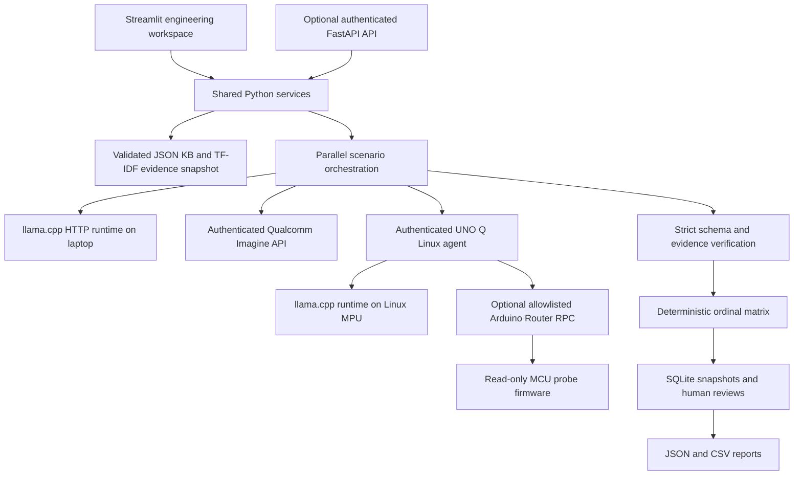

# SafeScenario AI

An engineering workspace for proposing evidence-linked safety scenarios for autonomous sidewalk delivery robots. It includes independent laptop, Qualcomm Imagine and Arduino UNO Q inference adapters, a Streamlit dashboard, an optional FastAPI API, SQLite history, deterministic verification and ordinal risk calculations.

The expanded starter includes 180 illustrative KB records, with three complete hazard, mitigation and test groups for each of five faults across four operating-condition buckets. Scenario Builder supports one to three faults together. Rain and reduced-visibility profiles use explicit provisional L3 likelihood inputs, so S3 hazards rank High in the illustrative matrix; this is not a measured probability or expert approval. Retrieval reserves complete groups across faults and risk reports identify any fault without an included scenario. See [multi-fault coverage](docs/multi_fault_coverage.md) for calculation rules and limitations.

**Status:** Functional local application with real integration boundaries and automated tests. No real model, cloud account or UNO Q has been used to verify inference in this development environment. Initial datasets, benchmark labels and risk policy are explicitly illustrative. See [implementation status](docs/status.md) for the acceptance checklist and limitations.

## Start on Windows

Python 3.10–3.12 recommended. Run from the project directory:

```powershell
python -m venv .venv
.\.venv\Scripts\python.exe -m pip install -r requirements.txt
Copy-Item .env.example .env
# Edit .env locally with your configured endpoints and credentials.
.\.venv\Scripts\python.exe -m streamlit run app.py
```

Open [the dashboard](http://127.0.0.1:8501). The default address is loopback. No model download is automatic. The UI, knowledge-base editing, history, risk matrix editing, and toy software simulation work without inference credentials.

## Start on Linux

```bash
python3 -m venv .venv
.venv/bin/python -m pip install -r requirements.txt
cp .env.example .env
.venv/bin/python -m streamlit run app.py
```

Top-level dependencies are pinned in `requirements.txt`. A complete dependency snapshot from the tested Python 3.10 Windows environment is in `requirements-lock.txt`; use it for the same environment. Linux wheels and board resource availability must be verified on the target. Do not copy the Windows virtual environment to Linux.

## Architecture



## Features and workflow

The interactive default is now **AI writes scenarios → KB screening → engineer cross-check**. Select a maximum of 1-20 distinct scenarios per model. The model composes cited hazard, mitigation and acceptance-test statements; the server accepts exact KB description matches with valid links and retains unsupported drafts with rejection reasons. In Scenario Register, engineers can reject/exclude scenarios and immediately see recalculated risk and support metrics. Risk Analysis and JSON/CSV/PDF engineering reports use the same frozen-input recalculation. Excluding all scenarios leaves risk unassigned. See the [current architecture](docs/architecture.md) for the screening limits and the compatible earlier selection mode.

The current validity upgrade uses constrained record selection, expert risk inputs, filtered TF-IDF, a no-AI baseline and repeated labelled evaluation. Start with the [revised architecture](docs/architecture.md) and [prioritized implementation plan](docs/implementation_plan.md). The active starter is a 10-record v2 draft; the earlier expanded catalogue is retained for legacy exploration and history. No domain-expert approval or real inference performance is claimed.

The review revision adds citation_link_validity, separate expert support review, a 25-case preliminary set, risk exact-match/ordinal error/confusion matrices, and run_experiment across all four modes. Every metric shows unique case counts and repeated-run spread. Failed runs remain in the results. The comparison view shows one results table, accuracy bars and measured run-duration distributions; complete JSON/CSV/PDF experiment reports are available from Evaluation and Benchmarks.

The dashboard includes a complete Scenario Register, graphical baseline/model comparisons and cached TF-IDF search with visible relevance/timing diagnostics. The [earlier retrieval measurements](docs/retrieval_and_analytics.md) describe the archived 181-record catalogue, not current v2 accuracy.

1. In **Settings**, configure the three endpoints, independent model IDs and generation parameters. Credentials come from environment variables or an ignored `.env` file. Restart after changing environment configuration.
2. In **Model Studio**, refresh the actual runtime/service catalogue and select a model separately for each backend. Listing is not proof of successful inference. The default llama.cpp server does not expose portable load/unload operations; those controls are visibly disabled.
3. In **Knowledge Base**, upload JSON, inspect structural validation and record previews, then explicitly activate it. Invalid uploads leave the active dataset unchanged. Download the schema and sample from the page. Search, filter, edit/add/delete records through the dataset JSON editor, and restore saved versions.
4. In **Scenario Builder**, save validated environment, robot and fault inputs. Inspect retrieved records. Choose one to three backend/model pairs and run them. Fault options come from the active KB, with unsupported faults describable in notes.
5. **Model Comparison** runs the saved inputs against selected backends with one frozen evidence snapshot. Each backend progresses independently; failures retain successful peers. Cancellation is cooperative, and an in-flight cloud request can still finish or be billed. There is no automatic backend fallback.
6. **Reports and History** reopens immutable runs, shows full scenario/evidence detail, stores separate attributed human decisions, and exports individual scenarios, complete engineering reports, collections and comparison tables as JSON/CSV. Click **Prepare engineering PDF** for a paginated report, then download it.
7. **Risk Analysis** calculates an ordinal score immediately for system-accepted scenarios from severity and likelihood stored in the frozen knowledge base. Pending or illustrative inputs produce a clearly labelled provisional result. Missing or conflicting inputs remain blank. Engineer exclusions then recalculate the overall result from the remaining scenarios. The bundled matrix stays marked illustrative.
8. **Test Simulation** executes a documented toy watchdog state machine with pass/fail/inconclusive outputs. It neither controls a robot nor simulates physical braking.
9. **Evaluation and Benchmarks** imports labels or downloads 25 preliminary draft cases, then evaluates baseline and every adapter with shared evidence/settings over 3-5 repetitions. Failed runs remain recorded. Reports include precision/recall, risk-category exact match, ordinal distance, review-required correctness, confusion matrices, mean and spread with unique case counts. Cloud execution may incur charges.
10. **Device Control** reaches the installed board agent over local Wi-Fi, reads actual status/logs and exposes only confirmed firmware capabilities. Connect it using the [UNO Q setup guide](docs/uno_q_setup.md).

11. **Scenario Register** lists all identifiable AI proposals across all saved runs. Filter and inspect proposals, record human acceptance/rejection/follow-up decisions, and export the complete inventory. Overview totals use the latest decision for each proposal; validation is displayed separately from human approval.

## First real inference

- **Laptop:** run a compatible GGUF with a separately installed llama.cpp `llama-server`, point the app at `http://127.0.0.1:8080`, refresh the catalogue, select the exact returned ID, and click **Test real scenario inference**. See [local model setup](docs/local_models.md).
- **Qualcomm:** set `QUALCOMM_API_KEY` to your authorized Imagine Bearer token, retain the documented HTTPS base URL, restart, refresh models and select a returned chat-capable model. See [Qualcomm setup](docs/qualcomm_setup.md).
- **UNO Q:** install the agent on the Linux MPU, configure its local runtime and authentication, enter the board's private hostname/IP in the dashboard, connect, refresh models, select a returned model and test. See [UNO Q setup](docs/uno_q_setup.md).

## Optional REST API

Set `SAFESCENARIO_API_TOKEN` before starting:

```powershell
.\.venv\Scripts\python.exe -m uvicorn backend.api:app --host 127.0.0.1 --port 8000
```

The `/health` route reports application liveness only. `/v1/runs`, `/v1/runs/{id}` and its `/cancel` operation require `Authorization: Bearer <your configured token>`. [Interactive OpenAPI](http://127.0.0.1:8000/docs) describes the exact input schema. Streamlit and the REST API share SQLite but maintain separate active job managers: poll/cancel a run in the process that started it. Completed results are shared through history.

## Tests

```powershell
.\.venv\Scripts\python.exe -m pytest -q
.\.venv\Scripts\python.exe -m compileall -q app.py backend models knowledge_base risk_engine verification simulation evaluation reporting ui uno_q_agent
```

Tests isolate runtime data and use mocks only for external service responses. See [test methodology](docs/testing.md). No actual external inference success is implied by mocked integration tests.

## Configuration, storage and security

- Copy `.env.example` locally; `.env`, model binaries, runtime SQLite and logs are ignored by Git.
- `LOCAL_MODEL_DIRS` contains permitted directories separated by the OS path separator (`;` on Windows, `:` on Linux). GGUF scanning is shallow, bounded and symlink-checked. Manual file registration requires a path inside those directories.
- `SAFESCENARIO_DATA_DIR` selects runtime storage. Each run retains a complete KB, matrix, request, prompt version, endpoint configuration, evidence snapshot, timings and a configuration hash. It stores no adapter credentials.
- Set `SAFESCENARIO_RETAIN_RAW=true` explicitly to retain raw model text. Otherwise diagnostics include response hash, size and validation errors. Model text and uploaded content remain untrusted data; no output triggers hardware operations.
- Cloud URLs require HTTPS and an explicitly allowlisted hostname; local runtime URLs require loopback. Board URLs require private resolved addresses. HTTP redirects and environment proxy inheritance are disabled.
- Local HTTP board traffic assumes a trusted private network. Use a protected network or appropriately configured TLS/private VPN; do not expose the agent to the public internet.
- History clearing is a confirmed, permanent local action. Export records first if needed. Dataset versions and preferences are retained.

Detailed [security notes](docs/security.md), [architecture](docs/architecture.md), [KB schema](docs/knowledge_base_schema.md), and [known limitations](docs/status.md).

## Troubleshooting

| Symptom | Check |
| --- | --- |
| Empty catalogue | Runtime is running, base URL correct, credentials configured, refresh requested |
| Cloud authentication error | Authorized token/account access; credentials changed before process startup |
| Board unreachable | Wi-Fi setup, private IP/hostname resolution, agent bind address/firewall, matching tokens |
| GGUF exists but is not listed | File scanning does not load it: explicitly start llama-server with that file |
| Invalid model JSON | Inspect validation errors; increase max tokens if truncated; use a model capable of structured JSON |
| Risk remains unassigned | Supply reviewed source evidence and human classification; illustrative sample cannot support confident scoring |
| Stale connection indicator | Indicators describe last check; refresh status/catalogue explicitly |
| Prior run not found while running | Active jobs belong to their originating process; completed history persists across restarts |

This software supports engineering review. AI proposals and illustrative policy are not certification or formal safety approval.
