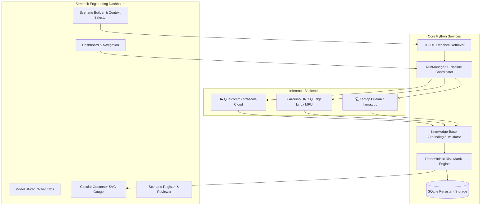

# SafeScenario AI

An engineering workspace and autonomous safety verification platform for proposing, cross-checking, and evaluating evidence-linked safety scenarios for autonomous sidewalk delivery robots.

SafeScenario AI bridges high-performance cloud reasoning, physical edge microcontrollers, and offline local inference into a unified 3-tier safety engineering pipeline with deterministic knowledge-base screening, real-time risk recalculation, and a sleek circular odometer dial.

---

## Key Highlights

* **3-Tier Execution Architecture:**
  * **Qualcomm Cloud Hub:** High-throughput reasoning and large language model inference (e.g. `DeepSeek-R1-Distill-Llama-70B`) via Qualcomm Imagine / Cirrascale endpoints.
  * **Arduino UNO Q Edge Station:** On-device edge inference (`qwen3:0.6b`) on the Linux MPU communicating via ADB port forwarding (`5000:5000`) with physical LED actuation via Arduino Bridge RPC.
  * **Laptop Local Station:** Private, offline inference via Ollama / llama.cpp with fast no-think JSON output modes.
* **Circular Odometer / Speedometer Risk Gauge:** Real-time SVG odometer dial with calibrated needle sweep, dynamic color gradient arc, and instant risk level pills (`LOW RISK`, `MEDIUM RISK`, `HIGH RISK`).
* **Deterministic Risk Recalculation:** Standardized $0 - 100$ safety risk index computed from frozen expert severity and likelihood matrices. Reviewers can remove or restore proposals with real-time recalculation.
* **Clean, Professional UI:** Curated pastel design system with high-contrast badge pills (`HAZARD`, `MITIGATION`, `VERIFICATION TEST`) and zero noisy emoji clutter.
* **100% Test Coverage:** 179 automated unit, integration, and adapter tests passing consistently.

---

## Architecture Overview



---

## Quick Start Guide

### 1. Prerequisites
* Python 3.10 to 3.12 (tested on Windows 11 & Linux)
* Git

### 2. Installation (Windows PowerShell)

```powershell
# Clone the repository
git clone https://github.com/Anandhanachu/safety_scenario_generator.git
cd safety_scenario_generator

# Create virtual environment and install dependencies
python -m venv .venv
.\.venv\Scripts\Activate.ps1
python -m pip install -r requirements.txt

# Configure environment variables
Copy-Item .env.example .env
```

### 3. Running the Dashboard

```powershell
python -m streamlit run app.py
```
Open [http://127.0.0.1:8501](http://127.0.0.1:8501) in your browser.

---

## Hardware Edge Setup: Arduino UNO Q

The platform supports direct edge inference and hardware telemetry on the Arduino UNO Q board:

1. **ADB Port Forwarding:** Forward the board's Flask/FastAPI server port to localhost:
   ```powershell
   adb forward tcp:5000 tcp:5000
   ```
2. **Dashboard Configuration:**
   * In **Settings**, set Arduino UNO Q base URL to `http://127.0.0.1:5000`.
   * Set target model ID to `qwen3:0.6b`.
3. **Real-Time RPC & `/predict`:**
   * In **Model Studio** $\rightarrow$ **Arduino UNO Q**, test live predictions (`/predict`) and trigger the onboard LED via the MCU Bridge interface.

---

## Project Structure

```
safetyscenariogenerator/
├── app.py                      # Main application entry point
├── requirements.txt            # Python dependencies
├── pytest.ini                  # Pytest configuration
├── backend/                    # Core business logic
│   ├── adapters.py             # Inference adapters (Qualcomm, Uno Q, Local)
│   ├── persistence.py          # SQLite database storage & runs
│   ├── retrieval.py            # TF-IDF evidence search
│   ├── scenario_generation.py  # AI proposal screening & risk engine
│   └── constrained.py          # Grammar & schema validation
├── ui/                         # Streamlit user interface
│   ├── dashboard.py            # Primary UI views, gauges & panels
│   └── charts.py               # Plotly telemetry & latency charts
├── runtime/                    # SQLite database and run artifacts
└── tests/                      # Automated test suite (179 tests)
    ├── test_adapters.py
    ├── test_integration.py
    ├── test_scenario_drafts.py
    └── test_board_registration.py
```

---

## Verification & Automated Testing

Run the full pytest suite to verify all integration points and deterministic risk algorithms:

```powershell
python -m pytest
```

Expected output:
```
======================= 179 passed, 1 warning in 14.09s =======================
```

---

## Verification Policy & Safety Notice

SafeScenario AI is an engineering decision-support tool designed for safety and systems engineers. Generated scenarios and risk indices are intended for review, validation, and automated testing frameworks, and do not constitute formal ISO 26262 functional safety certification without qualified human sign-off.
